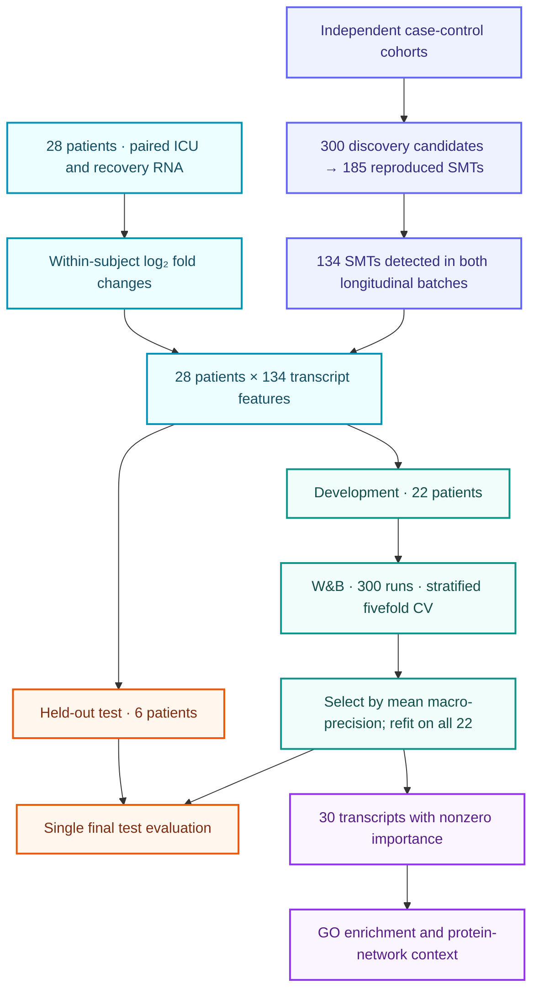

# Septic Shock Classification
# AI Agent–Assisted MLOps
### Within-Subject Platelet Transcriptome Dynamics

**Paired RNA-seq · Mechanism-informed features · Random Forest · MLOps**

A proof-of-concept study of septic shock classification in a small cohort.

[Overview](#overview) · [Workflow](#workflow) · [Results](#results) · [Reproducibility](#reproducibility) · [Citation](#citation)

---

## Overview

Can patient-specific changes in platelet RNA distinguish **septic shock from sepsis without shock** in a small cohort?

This project combines two complementary strategies: **within-subject transcriptome contrasts**, using ICU-admission and recovery samples from the same patient, and **biologically anchored feature restriction**, using a Sepsis Mechanism Transcript (SMT) set reproduced in independent case-control cohorts.

A Random Forest classifier was developed with Weights & Biases (W&B) experiment tracking, stratified fivefold cross-validation, and a separate held-out test set.

**Associated manuscript:** *Septic Shock Classification from Within-Subject Platelet Transcriptome Dynamics in a Small Cohort: A Proof-of-Concept.*

**Repository status:** This initial version documents the manuscript workflow and reported findings. Executable analysis code, dependency versions, and run instructions are not included in this documentation release.

## Study at a glance

| Component | Study design |
|:--|:--|
| Classification task | Septic shock vs. sepsis without shock |
| Longitudinal cohort | 28 survivors: 12 with shock and 16 without shock |
| Sampling | Within 48 hours of ICU admission and approximately 90 days after discharge |
| RNA profiles | 56 platelet transcriptomes; two per patient |
| Input representation | One within-subject log₂ fold-change vector per patient |
| Input features | 134 SMT transcripts detected in both longitudinal batches |
| Development set | 22 patients: 9 with shock and 13 without shock |
| Held-out test set | 6 patients: 3 with shock and 3 without shock |
| Model development | 300 W&B sweep runs with stratified fivefold cross-validation |
| Selection criterion | Highest mean cross-validated macro-precision |
| Transcript prioritization | 30 transcripts with nonzero impurity-based importance in the selected model |

## Workflow

The independent case-control cohorts establish the SMT feature set. They are separate from the longitudinal cohort used for shock classification. Both RNA samples from a patient contribute to one feature vector, so partitioning is at the **patient level**.

## Methods

### Transcript representation

Of 300 discovery transcripts, 185 reproduced in an independent case-control cohort with consistent direction and FDR < 0.05. The classifier used the 134 SMT transcripts passing expression filtering in both longitudinal batches, represented as ICU-admission-versus-recovery log₂ fold changes.

Batch-effect removal and transcript Z-scoring described for the manuscript heatmap were used for visualization; they were **not classifier input transformations**.

### Random Forest and MLOps

W&B sweep agents executed training trials and recorded fold-level accuracy, macro-precision, macro-recall, and macro-F1. Human review supported failure analysis and refinement of the search space.

| Hyperparameter | Search space |
|:--|:--|
| `criterion` | `gini`, `entropy` |
| `n_estimators` | 5–150 |
| `max_features` | `sqrt`, `log2`, `None` |
| `max_depth` | 5–150 |

The configuration with the highest mean cross-validated macro-precision was selected, retrained on all 22 development patients, and evaluated once on the six held-out patients. Cross-validation supported model selection; the performance values below are from the held-out test set.

The 30 prioritized transcripts had nonzero mean-decrease-in-impurity importance in the selected fitted model. They are an interpretation of the model trained with 134 input features, rather than a separately evaluated 30-feature refit.

## Results

**Five of six held-out patients were classified correctly.**

| Held-out metric | Reported value |
|:--|--:|
| Accuracy | 0.833 |
| Macro-precision | 0.875 |
| Macro-recall | 0.833 |
| AUROC | 0.89 |

**Confusion matrix — patient counts**

| Actual class | Predicted shock | Predicted no shock |
|:--|--:|--:|
| Septic shock | 2 | 1 |
| Sepsis without shock | 0 | 3 |

The prioritized transcripts implicated toll-like receptor signaling and cellular stress responses. Fourteen of the 30 prioritized transcripts mapped to the 55-protein connected core of the SMT interaction network.

**Interpretation:** These findings establish retrospective classification in a small survivor cohort. Recovery samples served as surrogates for pre-sepsis baselines, and sampling relative to shock onset was not recorded. Prospective prediction and clinical utility remain unestablished. With six test patients, one changed classification shifts accuracy by approximately 16.7 percentage points.

## Reproducibility

The software release should provide the following components alongside verified execution commands:

| Component | Required record |
|:--|:--|
| Environment | Exact Python/R and package versions |
| Data preparation | Filtering, normalization, transcript mapping, and fold-change calculation |
| Partitioning | Fixed patient assignments, class encoding, and random seeds |
| Model selection | Sweep configuration, fold assignments, selected run, and selection rule |
| Evaluation | Class predictions, probability scores, confusion matrix, and metric settings |
| Interpretation | Transcript importance table and enrichment/network analysis inputs |

## Data availability

The discovery and validation datasets are described in the manuscript's cited source studies. The manuscript states that the longitudinal cohort will be deposited in **NCBI dbGaP**; an accession is not provided in the supplied version.

For data-access inquiries, contact **Matthew T. Rondina** at [Matthew.Rondina@hsc.utah.edu](mailto:Matthew.Rondina@hsc.utah.edu). Access is subject to the applicable study and repository requirements.

## Citation

Shabanian M, Pouladi N, Wilson LS, Morgan K, Li J, Kenost C, Middleton EA, Tolley N, Campbell RA, Nelson R, Rowley JW, Lussier YA, Rondina MT. *Septic Shock Classification from Within-Subject Platelet Transcriptome Dynamics in a Small Cohort: A Proof-of-Concept.* Manuscript.

Mahdieh Shabanian and Nima Pouladi contributed equally. Publication details and the DOI should be added when available.

## Contact

Corresponding authors:

- **Yves A. Lussier:** [Yves.Lussier@utah.edu](mailto:Yves.Lussier@utah.edu)
- **Matthew T. Rondina:** [Matthew.Rondina@hsc.utah.edu](mailto:Matthew.Rondina@hsc.utah.edu)

## License

A software license has not been specified in this documentation release. The software license and any separate data-use terms should accompany the code release.

---

**Research use only. This proof-of-concept classifier is not a validated clinical decision-support tool.**
